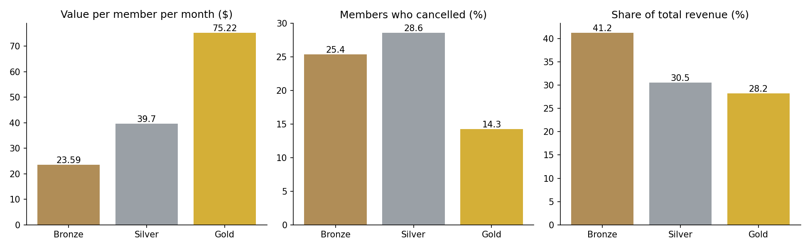

# Membership Club Toolkit

A set of small Python scripts for cleaning up customer data: merging messy exports into one list, linking survey answers to the right customer, splitting customers by type, and working out what each type is worth.

## Why this exists

For a DECA research project I had about 60 survey responses in a spreadsheet, filled in inconsistently. I cleaned them by hand in Excel and Google Sheets, split them by type of customer, and compared the groups on a few key numbers. That worked for 60 rows, but it was slow, and every fix was one I could get wrong without noticing.

This repo is that same process written as code, so it can be rerun on a new export in a few seconds and gives the same answer every time. I set it up around a membership club (tiers, a monthly fee, a newsletter) because that kind of business has the same problem in a bigger form: the same customer shows up in the signup form, the cash register, the email tool and the survey, and none of them agree.

**All the data in this repo is made up.** `make_sample_data.py` generates it, mess included. Nothing here is from the DECA project or from any real business.

## What it does

| Step | Script | What you get |
|---|---|---|
| 1 | `clean_customers.py` | One clean customer list from three messy exports |
| 2 | `link_surveys.py` | Survey answers cleaned, linked to customers, and split by membership tier |
| 3 | `tier_value.py` | What each membership tier is worth |
| 4 | `email_journeys.py` | Drafts of the member emails that are due, waiting for a person to approve them |

### Step 1: one clean list

It turns this (three files, three formats):

```
signup form:  ANDRE.FLORES44@EXAMPLE.COM, 2105556737, Silver
register:     "FLORES, Andre", andre.flores44@example.com, (210) 555-6737, Sampler pack, 48.00
newsletter:   Andre.flores44@example.com , Andre Flores, no
```

into one row:

```
C1012, Andre, Flores, andre.flores44@example.com, 2105556737, Silver, active, 2025-02-13, , False, 12, 346.0, 2026-09-10
```

- Emails are lowercased and trimmed, so different spellings of the same address match.
- Phone numbers are cut down to 10 digits, so `(210) 555-6737` and `210.555.6737` match.
- If someone filled out the signup form twice, the earliest signup is kept.
- A register sale with no email is matched to a person by phone number. In the sample data that rescues 90 of 92 sales.
- Sales that match nobody are kept as non-member customers.
- At the end it checks that total dollars in the clean list equals total dollars in the raw sales file ($14,954.00 both ways in the sample). If cleaning lost a sale, the two numbers would not match.

### Step 2: link the surveys

Survey exports are messy in their own way. The column names are whole questions, and people answer the same question as `4`, `4/5`, or `four`. Some answer twice and some leave the email blank.

```
Survey linking report
---------------------
Responses read:                  60
Linked to a customer by email:   45
Linked by phone (no email given): 12
Could not be linked:             3
Repeat answers removed:          5
People in the final file:        52

  tier  responses  response_rate_pct  avg_satisfaction  net_promoter_score  avg_contacts_per_year
Bronze         33               46.5              3.30                 -42                   1.39
Silver         14               40.0              3.43                 -50                   2.71
  Gold          5               35.7              3.40                 -20                   3.20
```

Once the answers are linked to customers, they can be split by anything in the customer list. In the sample, members who later cancelled rated the club 2.58 out of 5 and active members rated it 3.58. Bronze members said they heard from the club about 1.4 times a year and Gold members about 3.2 times. Neither comparison is possible while the survey is its own separate spreadsheet.

### Step 3: what each tier is worth

```
tier                       Bronze    Silver      Gold
members                        71        35        14
churn_rate_pct               25.4      28.6      14.3
avg_months_stayed            12.0      10.7      13.1
value_per_member_month      23.59      39.7     75.22
value_per_member_so_far    283.08    424.79    985.38
share_of_revenue_pct         41.2      30.5      28.2
```



In the sample data, a Gold member is worth about three times a Bronze member, but Bronze still brings in the most money overall because there are five times as many of them.

- **Churn rate** = members who cancelled / all members who ever joined that tier
- **Months stayed** = signup date to cancel date (or to today for active members)
- **Value per member per month** = monthly fee + extra purchases per member per month
- **Value per member so far** = value per month x average months stayed

This is a simple version of customer lifetime value on purpose. It only counts months that have already happened, so it runs low for tiers where most members are still active.

### Step 4: email drafts for review

| Journey | Who gets it |
|---|---|
| Welcome | Active members who joined in the last 7 days |
| Anniversary | Active members whose join anniversary is within the next 7 days |
| Win-back | Members who cancelled 30 to 120 days ago |

```
To: tara.garza14@example.com
Subject: 2 years as a member. Thank you, Tara!

Hi Tara,

Next week marks 2 years since you joined the club as a Bronze member.
...
```

Two safety rules: people who are not subscribed to the newsletter are skipped, and nothing is sent. Every draft goes into `outbox_for_review/` and starts as `approved = NO` in `review_queue.csv`. A person has to read it and change that to YES.

## How to run it

You need Python 3.9 or newer.

```
pip install -r requirements.txt

python make_sample_data.py     # optional, the sample data is already in data/raw
python clean_customers.py      # step 1
python link_surveys.py         # step 2
python tier_value.py           # step 3
python email_journeys.py       # step 4

python -m unittest discover tests
```

## What is in here

| File | What it does |
|---|---|
| `make_sample_data.py` | Makes the fake, messy exports in `data/raw/` |
| `clean_customers.py` | Cleans and merges three exports into `data/clean/customers_clean.csv` and writes a cleaning report |
| `link_surveys.py` | Cleans survey answers, links them to customers, and reports the key numbers by tier |
| `tier_value.py` | Calculates churn, months stayed, and value for each tier. Saves a table and a chart in `reports/` |
| `email_journeys.py` | Picks who is due for which email and writes drafts plus `review_queue.csv` |
| `templates/` | The email wording, as plain text files anyone can edit |
| `docs/data_dictionary.md` | What every column in the clean files means and how records are matched |
| `docs/handover.md` | How to run this with real data and what to change |
| `tests/` | 16 small tests for the cleaning rules, the survey parsing and the email rules |

## Skills this project uses

- **Data cleaning**: standardizing emails, phones, names and survey answers, removing duplicates, and merging several sources into one table
- **Linking records**: matching the same person across files by email, then by phone, and reporting what could not be matched
- **Data analysis** with Python and pandas: splitting customers by type, churn, customer value, survey scores and Net Promoter Score, and charting with matplotlib
- **CRM basics**: one customer record per person, a documented data dictionary, and member status and tier tracking
- **Email automation**: date-based trigger rules, fill-in templates, opt-out handling, and a human approval step
- **Documentation and testing**: a handover guide, a data dictionary, and unit tests

## Limits

- People are matched by email first and phone second. Someone who uses two emails and two phone numbers shows up as two people.
- The sample is small. Only 5 Gold members answered the survey, so the Gold survey numbers could change a lot with a few more answers.
- People who answer surveys are not the same as people who do not, so a 40% response rate does not describe the other 60%.

## Ideas for later

- Load the clean list into SQLite so it can be queried with SQL
- Add a "has not ordered in 60 days" check-in email for active members
- Compare tiers by the month people joined, to see if newer members cancel faster
